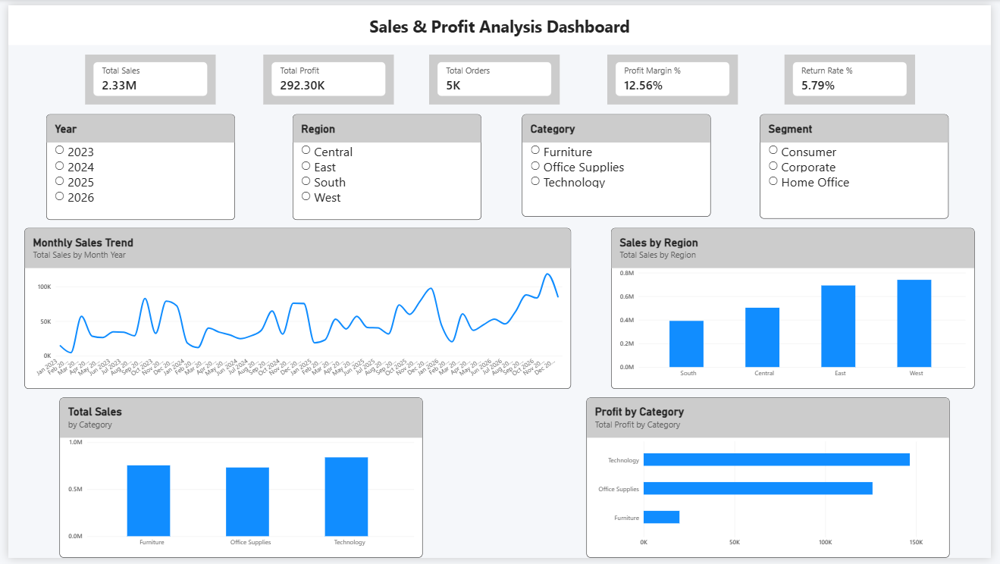

# Sales & Profit Analysis Dashboard – Power BI

## 📊 Project Overview

An interactive Sales & Profit Analysis Dashboard developed using Microsoft Power BI to analyze sales performance, profitability, orders, returns, regional performance, and category-level trends.

## 🎯 Objectives

- Monitor overall sales and profit performance
- Analyze monthly sales trends
- Compare sales performance across regions
- Analyze sales by product category
- Evaluate profitability by category
- Monitor order volume and return rate
- Provide interactive filtering for business analysis

## 🛠️ Tools & Technologies

- Microsoft Power BI
- Power Query
- DAX
- Microsoft Excel

## 📌 Key KPIs

- Total Sales
- Total Profit
- Total Orders
- Profit Margin %
- Return Rate %

## 📈 Dashboard Features

- Monthly Sales Trend
- Sales by Region
- Sales by Category
- Profit by Category
- Year filter
- Region filter
- Category filter
- Segment filter

## 🧮 DAX Measures

Key measures created include:

- Total Sales
- Total Profit
- Total Orders
- Total Quantity
- Profit Margin %
- Returned Orders
- Return Rate %

## 🖼️ Dashboard Preview

## 📂 Files

- `Sales_Profit_Analysis.pbix` – Power BI dashboard
- `dashboard.png` – Dashboard preview
